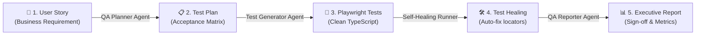

# 🎭 Playwright E2E QA - Agentic AI Workflow

[-success?logo=playwright)](./tests/)
[](https://www.typescriptlang.org/)
[](#-the-4-ai-agents-at-a-glance)
[](./LICENSE)

An autonomous, end-to-end testing showcase demonstrating how **Agentic AI workflows** transform modern software quality assurance: from analyzing user stories and generating test plans, to writing Playwright test scripts, automatically **self-healing broken locators**, and generating executive release reports.

Tested against the [SauceDemo E-Commerce Platform](https://www.saucedemo.com).

---

## ⚡ 60-Second Overview

Traditional QA requires manual test authoring, constant selector maintenance, and time-consuming test reporting. This project demonstrates an **Autonomous 4-Agent QA Pipeline** that handles the complete lifecycle:



---

## 🤖 The 4 AI Agents at a Glance

Each stage of the testing lifecycle is owned by a specialized AI agent with clear system prompts and deliverables:

| Agent | Name | Role & Responsibility | Key Deliverable |
| :---: | :--- | :--- | :--- |
| **01** | [**QA Planner Agent**](./agents/01-qa-planner-agent.md) | Ingests user stories, identifies edge cases, and maps out acceptance criteria | [`specs/saucedemo-checkout-test-plan.md`](./specs/saucedemo-checkout-test-plan.md) |
| **02** | [**Test Generator Agent**](./agents/02-test-generator-agent.md) | Converts test scenarios into idiomatic, resilient Playwright TypeScript specs | [`tests/saucedemo-checkout/*.spec.ts`](./tests/saucedemo-checkout/) |
| **03** | [**Self-Healing Agent**](./agents/03-self-healing-agent.md) | Detects runtime failures, inspects DOM snapshots, and patches broken selectors | Automated patches (raised pass rate from 90% to 100%) |
| **04** | [**QA Reporter Agent**](./agents/04-qa-reporter-agent.md) | Compiles execution results, coverage metrics, and sign-offs for stakeholders | [`test-results/SCRUM-101-checkout-test-report.md`](./test-results/SCRUM-101-checkout-test-report.md) |

---

## 🛠️ Spotlight: Self-Healing in Action

When modern web applications update, tests often break due to CSS or copy changes. The **Self-Healing Agent** diagnoses failure traces and repairs locators automatically without human intervention.

### Example: Brittle Selector Healed to Resilient Data-Test Attribute

**The Failure:**
```typescript
// ❌ Broke when DOM layout changed:
await expect(page.locator('.summary_value').filter({ hasText: 'SauceCard #31337' })).toBeVisible();
```

**The AI Self-Healing Patch:**
```typescript
// ✅ Healed automatically to resilient data-test locator:
await expect(page.locator('[data-test="payment-info-value"]')).toContainText('SauceCard #31337');
```

> **Result**: Pass rate improved from **90% (18/20)** to **100% (20/20)** with zero manual maintenance hours. Read full details in the [Self-Healing Guide](./agents/03-self-healing-agent.md).

---

## 🚀 Quick Start (Run in 2 Steps)

### 1. Clone & Install
```bash
git clone https://github.com/venkataratnamkarri-ai/Playwright-E2E-QA-AgenticAI-Workflow.git
cd Playwright-E2E-QA-AgenticAI-Workflow
npm install
```

### 2. Run All Tests
```bash
# Run headless test suite across all specs
npm test

# Run with interactive Playwright UI mode (recommended for demos!)
npm run test:ui

# View the rich HTML test execution report
npm run test:report
```

---

## 📂 Project Structure

```text
Playwright-E2E-QA-AgenticAI-Workflow/
├── .github/workflows/          # CI/CD Automated Testing Pipeline
│   └── playwright.yml
├── agents/                     # 🤖 The Agentic AI QA Architecture & Prompts
│   ├── README.md               # Multi-agent overview & lifecycle
│   ├── 01-qa-planner-agent.md  # Requirement analysis & test plan prompt
│   ├── 02-test-generator-agent.md # Code generation guidelines
│   ├── 03-self-healing-agent.md   # Self-healing case studies & prompt
│   └── 04-qa-reporter-agent.md    # Executive reporting prompt
├── user-stories/               # 📄 Stage 1: Input Requirements
│   └── SCRUM-101-ecommerce-checkout.md
├── specs/                      # 📋 Stage 2: AI-Generated Test Plan
│   └── saucedemo-checkout-test-plan.md
├── tests/                      # 🧪 Stage 3: Automated Playwright Specs
│   └── saucedemo-checkout/
│       ├── complete-checkout-flow.spec.ts
│       ├── cart-review.spec.ts
│       ├── checkout-information-validation.spec.ts
│       ├── order-overview.spec.ts
│       └── order-completion.spec.ts
├── test-results/               # 📊 Stage 4: Executive QA Report & Metrics
│   └── SCRUM-101-checkout-test-report.md
├── playwright.config.ts        # Playwright Test Runner Configuration
├── package.json
└── tsconfig.json
```

---

## 📊 Test Coverage & Sign-Off Matrix

| Acceptance Criteria | Description | Manual Tests | Automated Tests | Status |
| :--- | :--- | :---: | :---: | :---: |
| **AC1: Cart Review** | View cart items, quantities, prices, item removal | ✅ Passed | 4 specs | **100%** |
| **AC2: Information Entry** | First name, last name, zip code validations | ✅ Passed | 5 specs | **100%** |
| **AC3: Order Overview** | Item summaries, tax (8%) & total calculations | ✅ Passed | 5 specs | **100%** |
| **AC4: Order Completion** | Thank you screen, cart clearing, navigation reset | ✅ Passed | 3 specs | **100%** |
| **AC5: Error Handling** | Inline error banners, empty field dismissals | ✅ Passed | 5 specs | **100%** |
| **E2E Happy Path** | Full purchase journey from login to receipt | ✅ Passed | 1 E2E spec | **100%** |

**Release Recommendation:** ✅ **APPROVED FOR PRODUCTION** (Refer to [`test-results/SCRUM-101-checkout-test-report.md`](./test-results/SCRUM-101-checkout-test-report.md)).

---

## 📜 License
This project is licensed under the MIT License - see the [LICENSE](./LICENSE) file for details.
