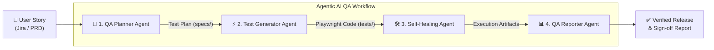

# 🤖 Agentic AI QA Architecture

This directory defines the **multi-agent AI workflow** powering this end-to-end testing repository. Rather than relying on manual test authoring, maintenance, and reporting, specialized AI agents collaborate across each stage of the software testing lifecycle.

---

## 🔄 The 4-Stage Autonomous QA Pipeline

---

## 👥 The Agents

| # | Agent Name | Primary Responsibility | Input | Output |
|---|------------|------------------------|-------|--------|
| **1** | [**QA Planner Agent**](./01-qa-planner-agent.md) | Requirement analysis, risk assessment & test scenario generation | User Story (`user-stories/*.md`) | Comprehensive Test Plan (`specs/*.md`) |
| **2** | [**Test Generator Agent**](./02-test-generator-agent.md) | Translates test plans into clean, idiomatic Playwright TypeScript code | Test Plan (`specs/*.md`) | Test Suites (`tests/**/*.spec.ts`) |
| **3** | [**Self-Healing Agent**](./03-self-healing-agent.md) | Detects runtime locator breaks, inspects DOM snapshots, auto-heals selectors | Failed Test Trace + Live DOM | Healed Specs (0 manual rework) |
| **4** | [**QA Reporter Agent**](./04-qa-reporter-agent.md) | Synthesizes test outcomes, coverage metrics & sign-offs into reports | Test Results + Healing Logs | Executive QA Report (`test-results/*.md`) |

---

## 💡 Why This Agentic Approach?

1. **Zero Flakiness Bottleneck**: The **Self-Healing Agent** automatically detects when application selectors change, updates the code, and re-validates without requiring human triage.
2. **100% Acceptance Criteria Traceability**: The **QA Planner Agent** directly maps every Acceptance Criterion to automated scenarios.
3. **Instant Stakeholder Communication**: The **QA Reporter Agent** transforms raw execution logs into executive summaries suitable for Product Managers and Engineering Directors.
